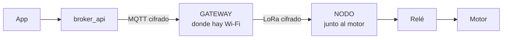

# esp32_lora — gateway y nodo del motor

Un proyecto, **dos firmwares** para dos ESP32 con módulo LoRa (SX1262). Juntos permiten encender y apagar un motor desde la app aunque el motor esté donde no llega el Wi-Fi.



| Firmware | Equipo | Qué hace |
|---|---|---|
| **gateway** (`pio run -e gateway`) | ESP32 + LoRa, donde hay Wi-Fi | Se conecta a **broker_api** por MQTT cifrado y reenvía el comando `motor` al nodo por LoRa |
| **nodo** (`pio run -e nodo`) | ESP32 + LoRa + relé, junto al motor | Sin Wi-Fi: enciende/apaga el relé con las órdenes del gateway y las confirma |

Versión actual: **0.4.0** (`FIRMWARE_VERSION` en `include/common_config.h`; el gateway la informa a la app como `fw`).

## Documentación

| Documento | Para qué |
|---|---|
| [docs/ARQUITECTURA.md](docs/ARQUITECTURA.md) | **Empieza aquí para entender o cambiar el código**: módulos, diagramas de arranque y de un comando, y dónde tocar cada cosa |
| [docs/GATEWAY.md](docs/GATEWAY.md) | Usar el gateway: vinculación con la app, portal de configuración, monitor serie y problemas comunes |
| [docs/FALLAS.md](docs/FALLAS.md) | Qué pasa si falla el nodo, el gateway, la radio o el servidor: cómo se entera cada parte y cómo reacciona |
| [docs/LORA.md](docs/LORA.md) | Enlace LoRa: formato de los mensajes, seguridad y la clave |
| [docs/CABLEADO.md](docs/CABLEADO.md) | Hardware: placas, pines, colores de cable y verificación |

El servidor y la app están en el proyecto **broker_api**; el protocolo MQTT está en `broker_api/docs/MQTT.md`.

## Estructura

```
esp32_lora/
├── platformio.ini          Los dos entornos: gateway y nodo
├── include/                AJUSTES: lo que se cambia sin tocar la lógica
│   ├── pins.h                Pines (iguales en los dos equipos)
│   ├── common_config.h       Versión del firmware y watchdog (los dos)
│   ├── lora_config.h         Radio y tiempos del enlace LoRa (los dos)
│   ├── gateway_config.h      MQTT, servidor por defecto, portal, botón BOOT (gateway)
│   ├── lora_key.h            Clave del enlace LoRa   (generado, no se versiona)
│   └── ca_cert.h             CAs de confianza        (generado por broker_api, no se versiona)
├── src/                    CÓDIGO
│   ├── lora/                 COMPARTIDO por los dos firmwares
│   │   ├── secure_link.*       Radio con tramas cifradas y autenticadas
│   │   └── protocol.h          Mensajes PING, SET_MOTOR y REPLY
│   ├── gateway/              Firmware del GATEWAY
│   │   ├── main.cpp            Arranque (portal o modo normal) y loop; une los módulos
│   │   ├── config_store.*      Configuración guardada en NVS
│   │   ├── provisioning.*      Portal Wi-Fi y vinculación con el servidor
│   │   ├── mqtt_link.*         Conexión MQTT (solo transporte)
│   │   ├── commands.*          Valida y ejecuta los comandos del servidor
│   │   ├── remote_motor.*      Motor del nodo por LoRa: órdenes, reintentos y consulta
│   │   ├── report.*            Estado y ack que se publican al servidor
│   │   └── led.*               LED de estado
│   └── nodo/                 Firmware del NODO
│       └── main.cpp            Relé, reto contra repeticiones y apagado por seguridad
├── scripts/lora_key.py     Crea include/lora_key.h en la primera compilación
└── docs/                   Documentación
```

Cada firmware compila su carpeta más `src/lora/`. Cómo se relacionan los módulos: [docs/ARQUITECTURA.md](docs/ARQUITECTURA.md).

## Compilar y subir

Con la extensión de PlatformIO en VS Code (botones de la barra inferior) o en terminal:

```bash
pio run                                   # compilar los dos
pio run -e gateway -t upload              # subir el gateway (USB); cierra antes el monitor serie
pio run -e nodo -t upload                 # subir el nodo
pio run -e nodo -t upload --upload-port COM6   # con los dos conectados, elegir el puerto
pio device monitor                        # ver los logs (115200 baudios)
```

En VS Code, el entorno (gateway / nodo) se elige en la barra inferior de PlatformIO antes de subir.

Dos archivos se generan y no se versionan:

- **`include/lora_key.h`** (clave del enlace LoRa): la crea la primera compilación, al azar. Los dos firmwares la usan: **sube gateway y nodo desde esta misma carpeta**. Si la borras, se genera otra y hay que subir los dos de nuevo. Detalle en [docs/LORA.md](docs/LORA.md#la-clave).
- **`include/ca_cert.h`** (autoridades en las que confía el gateway): hace falta **antes de compilar el gateway** y lo genera broker_api:

  ```bash
  # en broker_api
  pnpm certs:dev --firmware <ruta de esta carpeta>
  ```

  Depende de la CA de cada PC de desarrollo. Si cambia la IP de la PC, basta con volver a correr ese comando; la CA es la misma y el firmware no se recompila. Cómo funciona: `broker_api/docs/CERTIFICADOS.md`.

Librerías (se descargan solas): RadioLib (los dos), ArduinoJson y WiFiManager (gateway). El cliente MQTT es el de ESP-IDF (`esp_mqtt_client`), que ya viene en el core de Arduino y soporta `wss://` y `mqtts://`.

Tabla de particiones del gateway `min_spiffs.csv` (`board_build.partitions` en `platformio.ini`): 1,9 MB por app (el firmware ocupa ~59 %) manteniendo las dos particiones para OTA. La configuración guardada (NVS) está en el mismo lugar que con la tabla por defecto, así que cambiar de tabla no borra la vinculación.

## Puesta en marcha

1. Cablear los dos equipos: [docs/CABLEADO.md](docs/CABLEADO.md).
2. Generar `include/ca_cert.h` desde broker_api (arriba).
3. Subir el **nodo** y el **gateway** desde esta carpeta.
4. Vincular el gateway con la app: [docs/GATEWAY.md](docs/GATEWAY.md#primera-configuración-vinculación).

## Seguridad en breve

- Gateway ↔ servidor: HTTPS y MQTT con TLS, validando el certificado del servidor ([docs/GATEWAY.md](docs/GATEWAY.md#seguridad)).
- Gateway ↔ nodo: mensajes cifrados y autenticados (AES-128-GCM) con reto contra la repetición ([docs/LORA.md](docs/LORA.md#seguridad)).
- **Estado seguro**: el relé del nodo arranca apagado y se apaga solo si el nodo pasa 3 min sin noticias del gateway.

## Pendiente para el motor

- Acciones con rangos (velocidad, rampas) validadas aquí **y** en la API, y límites físicos que ningún comando pueda superar.
- Lo pendiente del enlace LoRa (botón local de paro, varios nodos, normativa): [docs/LORA.md](docs/LORA.md#pendiente).
