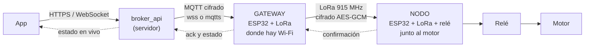
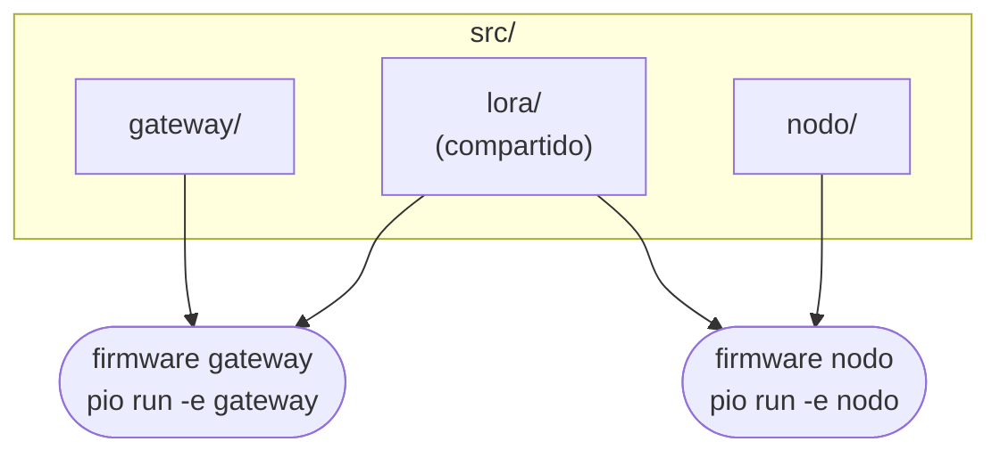
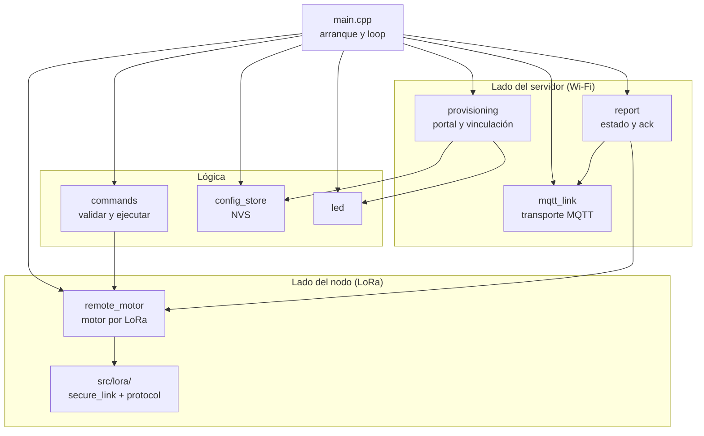
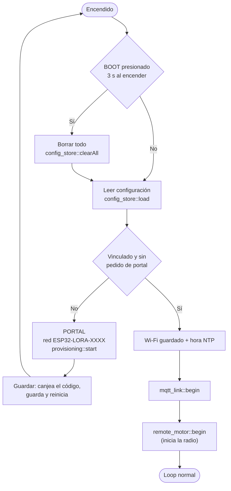
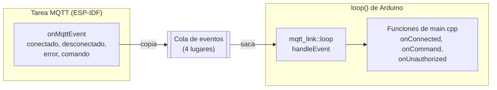
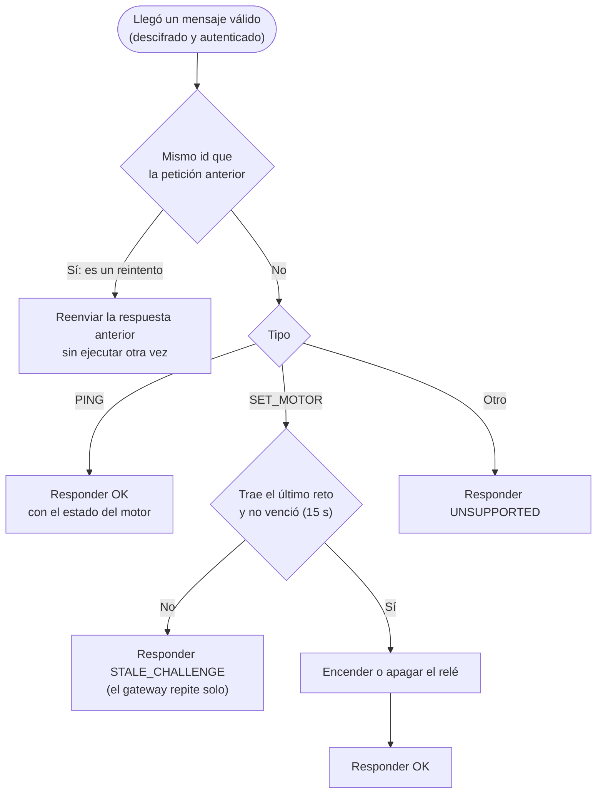
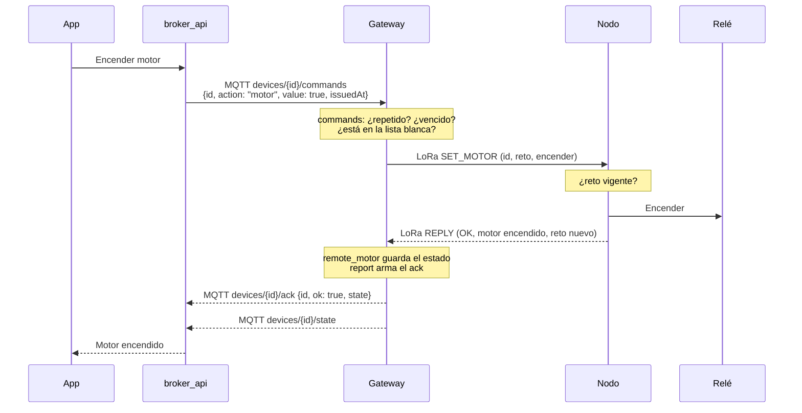
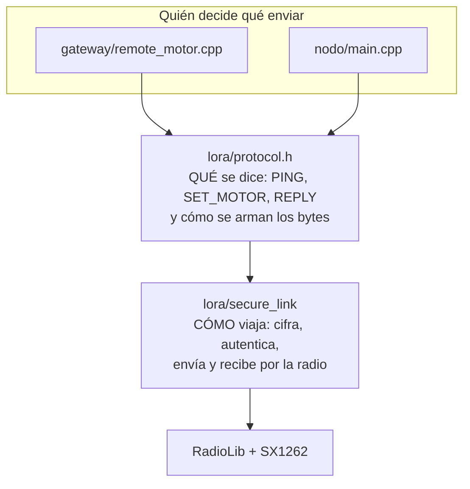

# Arquitectura del firmware

Cómo está organizado el código, qué hace cada parte y dónde tocar para cambiar algo.

Los diagramas están en Mermaid: GitHub los dibuja solo; en VS Code hace falta la extensión *Markdown Preview Mermaid Support*.

- [1. El sistema completo](#1-el-sistema-completo)
- [2. Carpetas y qué compila cada firmware](#2-carpetas-y-qué-compila-cada-firmware)
- [3. Gateway](#3-gateway)
- [4. Nodo](#4-nodo)
- [5. Un comando de principio a fin](#5-un-comando-de-principio-a-fin)
- [6. Enlace LoRa compartido](#6-enlace-lora-compartido)
- [7. Lo que se comparte con broker_api](#7-lo-que-se-comparte-con-broker_api)
- [8. Dónde cambiar cada cosa](#8-dónde-cambiar-cada-cosa)

## 1. El sistema completo



Este proyecto contiene los dos firmwares de la derecha. La app y el servidor están en el proyecto **broker_api**.

| Equipo | Tiene Wi-Fi | Qué hace |
|---|---|---|
| **Gateway** | Sí | Es el "dispositivo" vinculado en la app. Recibe el comando `motor` por MQTT, lo envía al nodo por LoRa y responde al servidor cuando el nodo confirma |
| **Nodo** | No | Solo escucha al gateway por LoRa. Enciende o apaga el relé y confirma cada orden |

## 2. Carpetas y qué compila cada firmware

```
esp32_lora/
├── platformio.ini          Los dos entornos: gateway y nodo
├── include/                AJUSTES: lo que se cambia sin tocar la lógica
│   ├── pins.h                Pines (iguales en los dos equipos)
│   ├── common_config.h       Versión del firmware y watchdog (los dos)
│   ├── lora_config.h         Radio y tiempos del enlace LoRa (los dos)
│   ├── gateway_config.h      MQTT, servidor por defecto, portal, botón BOOT (gateway)
│   ├── lora_key.h            Clave del enlace LoRa   (generado, no se versiona)
│   └── ca_cert.h             CAs de confianza        (generado por broker_api, no se versiona)
├── src/                    CÓDIGO
│   ├── lora/                 Compartido: radio cifrada y formato de los mensajes
│   ├── gateway/              Firmware del gateway
│   └── nodo/                 Firmware del nodo
├── scripts/lora_key.py     Crea include/lora_key.h en la primera compilación
└── docs/                   Documentación
```

Cada firmware compila **su carpeta más `src/lora/`** (`build_src_filter` en `platformio.ini`):



Por eso un cambio en `src/lora/` o en `include/lora_config.h` afecta a los dos equipos: hay que **subir los dos**.

## 3. Gateway

### Módulos

Cada módulo es un par `.h` / `.cpp` en `src/gateway/` y hace una sola cosa. `main.cpp` los une.

| Módulo | Qué hace | Habla con |
|---|---|---|
| `main.cpp` | Arranque (portal o modo normal) y loop. Aquí se ve el flujo completo | Todos |
| `config_store` | Guarda y lee la configuración en la memoria NVS: servidor, puertos, id y token; clave del portal | Flash del ESP32 |
| `provisioning` | Portal Wi-Fi de configuración y canje del código de vinculación por HTTPS | broker_api (`/api/devices/claim`) |
| `mqtt_link` | Conexión MQTT: conecta, reconecta, entrega comandos y publica. **Solo transporte**: no sabe qué dicen los mensajes | broker_api (broker MQTT) |
| `commands` | Valida un comando recibido (lista blanca, repetido, antigüedad) y lo ejecuta | `remote_motor` |
| `remote_motor` | El motor del nodo visto desde el gateway: enviar orden con reintentos, consulta cada 20 s, estado y señal | `src/lora/` |
| `report` | Arma el JSON de estado y el de ack y los publica | `mqtt_link`, `remote_motor` |
| `led` | LED azul: estado del motor o parpadeo en el portal | Pin del LED |



Las flechas son "usa a". Nadie usa a `main.cpp`, y `mqtt_link` no usa a ningún otro módulo: recibe de `main.cpp` tres funciones (`onConnected`, `onCommand`, `onUnauthorized`) y las llama cuando corresponde.

### Arranque



Abrir el portal con el equipo ya funcionando (BOOT 5 s) deja un "pedido de portal" guardado y reinicia: el arranque siguiente entra por la rama del portal conservando la vinculación.

### Loop normal

En cada vuelta (cada ~10 ms), en este orden:

1. `checkPortalButton` — ¿BOOT lleva 5 s presionado? Reinicia en el portal.
2. `logWifiChanges` — avisa por serie si el Wi-Fi se conectó o se cayó.
3. `mqtt_link::loop` — conecta o reconecta y atiende lo que llegó (ver abajo).
4. `remote_motor::loop` — cada 20 s consulta al nodo.
5. Si cambió el motor o la conexión del nodo: actualiza el LED y publica el estado.
6. Cada 30 s publica el estado aunque nada cambie (latido).

### Dos hilos, una cola

El cliente MQTT corre en su propia tarea. Para que la radio, el LED y el estado se manejen siempre desde un solo hilo, esa tarea **no ejecuta nada**: copia cada evento a una cola y el loop lo atiende.



Mientras un comando espera la respuesta del nodo (hasta 8 s) el loop está ocupado; los eventos que lleguen esperan en la cola, y si se llena se descartan.

## 4. Nodo

Todo el nodo está en `src/nodo/main.cpp`. No tiene Wi-Fi ni configuración guardada: solo la radio, el relé y tres reglas.



- **Cada respuesta lleva un reto nuevo**; el anterior deja de servir. Así un comando grabado por radio y reenviado después se rechaza.
- **Apagado por seguridad**: si el motor está encendido y pasan 3 minutos sin noticias del gateway, el nodo lo apaga solo (`checkFailsafe`).
- **Relé apagado desde el primer instante**: el pin arranca como entrada (alta impedancia).

## 5. Un comando de principio a fin



Qué funciones participan en el gateway:

| Paso | Función |
|---|---|
| Llega el mensaje MQTT | `mqtt_link` lo pone en la cola y luego llama a `onCommand` de `main.cpp` |
| Validar y ejecutar | `commands::handle` → `remote_motor::set` |
| Enviar por radio y esperar | `exchange` en `remote_motor.cpp` → `lora::send` / `lora::receive` |
| Responder al servidor | `report::publishAck` y, si salió bien, `report::publishState` |

Si algo falla:

| Caso | Qué pasa |
|---|---|
| El nodo no responde | El gateway reenvía la misma trama hasta 3 veces (1,2 s de espera cada una). Si no hay respuesta, el ack sale con `ok: false` y el error |
| El reto ya venció | El nodo responde `STALE_CHALLENGE` con un reto nuevo y el gateway repite el comando una vez |
| Se perdió la respuesta del nodo | El gateway reintenta con el mismo id; el nodo lo reconoce y repite la respuesta sin mover el relé otra vez |
| Comando repetido, vencido o desconocido | `commands` lo descarta o responde con error, sin usar la radio |

## 6. Enlace LoRa compartido

`src/lora/` tiene dos capas; el detalle del formato y la seguridad está en [LORA.md](LORA.md).



- `secure_link` no sabe nada de motores: recibe bytes, los cifra (AES-128-GCM con la clave de `include/lora_key.h`) y los transmite. Descarta lo que no venga del otro equipo con la misma clave.
- `protocol.h` define los mensajes una sola vez, para que gateway y nodo no puedan desacordarse.

## 7. Lo que se comparte con broker_api

El firmware y broker_api son proyectos separados que tienen que coincidir en estos puntos. Si cambias uno, revisa el otro.

| Qué | En el firmware | En broker_api |
|---|---|---|
| Tópicos MQTT `devices/{id}/commands`, `state`, `ack`, `status` | `src/gateway/mqtt_link.cpp` | `docs/MQTT.md` |
| Formato del comando (`id`, `action`, `value`, `issuedAt`) y lista blanca | `src/gateway/commands.cpp` | `docs/MQTT.md` |
| Campos del estado y del ack | `src/gateway/report.cpp` | `docs/MQTT.md` |
| Vinculación: `POST /api/devices/claim` devuelve `deviceId`, `token`, `mqttPort` | `src/gateway/provisioning.cpp` | `docs/API.md` |
| Ruta del WebSocket `/mqtt` y puertos 3443 / 8883 | `include/gateway_config.h` | `.env` y `docs/MQTT.md` |
| Certificados: `include/ca_cert.h` | Lo usan `mqtt_link.cpp` y `provisioning.cpp` | Lo genera `pnpm certs:dev --firmware <esta carpeta>` (`docs/CERTIFICADOS.md`) |
| Tiempos: el servidor espera el ack 10 s | `LORA_COMMAND_DEADLINE_MS` (8 s) debe ser menor | — |

## 8. Dónde cambiar cada cosa

| Quiero… | Archivo | Subir |
|---|---|---|
| Cambiar un pin | `include/pins.h` (y [CABLEADO.md](CABLEADO.md)) | Los dos |
| Cambiar frecuencia, potencia o alcance de la radio | `include/lora_config.h` | **Los dos** |
| Cambiar cada cuánto se consulta al nodo, los reintentos o el apagado por seguridad | `include/lora_config.h` | Los dos |
| Cambiar la versión del firmware | `include/common_config.h` | Los dos |
| Cambiar el latido, el servidor por defecto o los tiempos del botón BOOT | `include/gateway_config.h` | Gateway |
| Aceptar un comando nuevo de la app | `src/gateway/commands.cpp` (lista blanca) y broker_api | Gateway |
| Agregar un dato al estado que ve la app | `src/gateway/report.cpp` y broker_api | Gateway |
| Agregar un campo al portal | `src/gateway/provisioning.cpp` y `config_store` | Gateway |
| Agregar un mensaje LoRa nuevo | `src/lora/protocol.h`, luego `gateway/remote_motor.cpp` y `nodo/main.cpp`; documentarlo en [LORA.md](LORA.md) | **Los dos** |
| Cambiar cómo se maneja el relé | `src/nodo/main.cpp` (`setMotor`) | Nodo |
| Cambiar el cifrado o el formato de la trama | `src/lora/secure_link.cpp` y `LORA_PROTOCOL_VERSION` | **Los dos** |

Después de cualquier cambio, `pio run` compila los dos firmwares y avisa si algo quedó roto.
