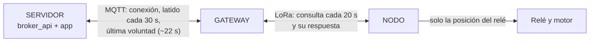
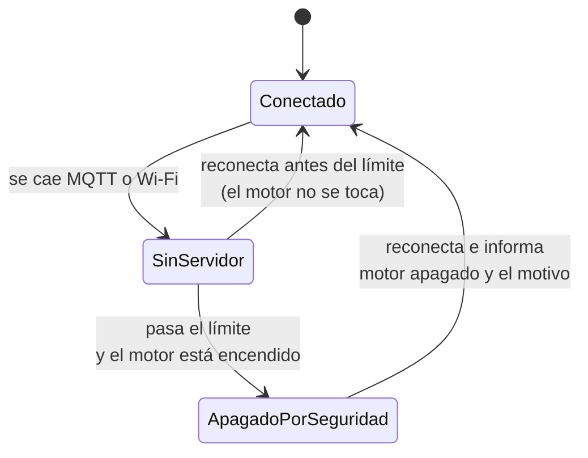

# Fallas y cómo reacciona cada parte

Qué puede salir mal en el mundo físico, quién se entera, en cuánto tiempo y qué hace cada parte: **nodo**, **gateway** y **servidor** (broker_api + app).

Cada situación está marcada así:

- ✅ **Hecho**: el firmware actual ya lo hace.
- ⚠️ **Parcial**: funciona, pero con un hueco que se describe.
- ❌ **Pendiente**: todavía no se hace; aquí queda la regla propuesta.

Cómo está hecho el código: [ARQUITECTURA.md](ARQUITECTURA.md). Enlace LoRa: [LORA.md](LORA.md).

- [1. Reglas generales](#1-reglas-generales)
- [2. Qué puede ver cada parte](#2-qué-puede-ver-cada-parte)
- [3. Falla el nodo](#3-falla-el-nodo)
- [4. Falla el enlace LoRa](#4-falla-el-enlace-lora)
- [5. Falla el gateway](#5-falla-el-gateway)
- [6. Falla el Wi-Fi o el servidor](#6-falla-el-wi-fi-o-el-servidor)
- [7. Fallan varias cosas a la vez](#7-fallan-varias-cosas-a-la-vez)
- [8. Lo que el firmware no puede ver](#8-lo-que-el-firmware-no-puede-ver)
- [9. Decisiones por tomar](#9-decisiones-por-tomar)
- [10. Pendientes en orden](#10-pendientes-en-orden)

## 1. Reglas generales

Estas reglas valen para cualquier falla, incluso las que no están en este documento.

1. **El estado seguro es el motor apagado.** Ante la duda, se apaga.
2. **Cada parte decide con lo que ella misma puede ver.** Ninguna espera a que otra le avise que algo falló: el silencio del otro *es* la señal.
3. **Quien está más cerca del motor tiene la última palabra.** El nodo se protege solo aunque el gateway y el servidor no existan.
4. **Nada se vuelve a encender solo.** Después de una falla, el motor solo se enciende con una orden nueva de una persona.
5. **Lo que se informa es lo confirmado.** El gateway informa el estado que el nodo confirmó, no el que se pidió. Si no lo sabe, lo dice.
6. **Una orden vieja no se ejecuta.** Un comando que llega tarde (después de una reconexión) se descarta.

## 2. Qué puede ver cada parte

| Parte | Cómo se entera de que el otro falló | En cuánto tiempo |
|---|---|---|
| **Nodo** | No oye ningún mensaje válido del gateway | Actúa a los **3 min** (`NODE_FAILSAFE_TIMEOUT_MS`) |
| **Gateway** → nodo | El nodo no responde 2 consultas seguidas | **~20 a 45 s** |
| **Gateway** → servidor | Se cierra la conexión MQTT o no hay Wi-Fi | **Segundos a ~30 s** |
| **Servidor** → gateway | Se cierra la conexión o vence el keepalive (última voluntad) | **~22 s** |
| **Servidor** → nodo | No lo ve directamente: el gateway le informa `nodeOnline: false` | **~20 a 45 s** |

Nadie ve el motor: el nodo sabe en qué posición dejó el relé, no si el motor gira (ver [sección 8](#8-lo-que-el-firmware-no-puede-ver)).

## 3. Falla el nodo

| Situación | Nodo | Gateway | Servidor y app | Estado |
|---|---|---|---|---|
| **Se queda sin corriente** | El relé se suelta: motor apagado al instante. Al volver arranca apagado | Lo marca desconectado tras 2 consultas sin respuesta y publica `nodeOnline: false` | La app muestra el nodo desconectado. Los comandos fallan con "El nodo del motor no responde por LoRa" | ✅ |
| **Vuelve la corriente** | Arranca con el relé apagado y espera al gateway | En la siguiente consulta (máx. 20 s) lo marca conectado y publica `motor: false` | La app muestra el motor apagado | ✅ |
| **El firmware se congela** | El watchdog lo reinicia a los 30 s, con el relé apagado. Durante esos 30 s el motor sigue como estaba | Igual que arriba | Igual que arriba | ✅ |
| **Se reinicia con el motor encendido** (p. ej. caída de voltaje al arrancar el motor) | Arranca apagado | Se entera en la siguiente consulta y publica el cambio | La app ve que el motor se apagó, pero **no sabe por qué**: el nodo no informa su motivo de reinicio | ⚠️ |
| **La radio no inicia al arrancar** | LED parpadeando 10 s y reinicio, en ciclo. Relé apagado | Lo marca desconectado | Nodo desconectado | ✅ |
| **Nodo desconectado con el motor encendido** | (según la causa, arriba) | Sigue informando `motor: true`, el último estado confirmado, junto a `nodeOnline: false` | La app puede mostrar "encendido" cuando ya se apagó | ⚠️ |

**Reglas propuestas para los ⚠️:**

- Mientras el nodo esté desconectado, el gateway **no informa `motor`** (o lo informa como desconocido). La app debe mostrar "estado desconocido", no el último valor.
- El nodo incluye en su respuesta una señal de **"me reinicié"** (y el motivo), para que el gateway la pase al servidor y la app pueda avisar "el motor se apagó porque el nodo se reinició".

## 4. Falla el enlace LoRa

El nodo y el gateway funcionan, pero no se oyen: antena suelta, interferencia, un obstáculo nuevo o demasiada distancia.

| Situación | Nodo | Gateway | Servidor y app | Estado |
|---|---|---|---|---|
| **Corte total** | A los 3 min sin oír al gateway apaga el motor | Marca el nodo desconectado en ~20 a 45 s y lo publica | Nodo desconectado; los comandos fallan con error | ✅ |
| **Vuelve el enlace** | Responde a la consulta | Lo marca conectado y publica el estado real | La app se actualiza sola | ✅ |
| **Enlace malo** (se pierden algunos mensajes) | Responde cuando oye | Reintenta cada mensaje hasta 3 veces; informa la señal (`loraRssi`, `loraSnr`) | La app muestra la señal | ✅ |
| **Se pierde la respuesta de un comando** (el nodo sí lo ejecutó) | Ya movió el relé. Si llega el reintento, repite la respuesta sin ejecutar dos veces | Si ningún reintento llega, responde al servidor con error. **El motor pudo haber cambiado**. La siguiente consulta (máx. 20 s) trae el estado real y lo publica | La app muestra el error y, poco después, el estado real | ⚠️ |
| **Alguien graba un comando y lo reenvía** | Lo rechaza: el reto ya venció o ya se usó | — | — | ✅ |
| **Alguien transmite con otra clave** | Lo descarta sin responder | Lo descarta | — | ✅ |

**Regla propuesta para el ⚠️:** tras un comando sin confirmación, el gateway consulta al nodo **de inmediato** en lugar de esperar hasta 20 s, y el error dice "sin confirmación: verificando el estado".

## 5. Falla el gateway

| Situación | Nodo | Gateway | Servidor y app | Estado |
|---|---|---|---|---|
| **Se queda sin corriente** | A los 3 min apaga el motor | — | El broker lo marca desconectado en ~22 s y la app avisa. No acepta comandos para él | ✅ |
| **Vuelve antes de 3 min** | El motor sigue como estaba | Arranca sin saber el estado, consulta al nodo de inmediato y lo publica, junto con el motivo del reinicio | La app vuelve a verlo en línea con el estado real | ✅ |
| **Vuelve después de 3 min** | Ya apagó el motor. No lo vuelve a encender | Publica `motor: false` | La app ve el motor apagado y el motivo del reinicio del gateway | ✅ |
| **El firmware se congela** | Si dura menos de 3 min, nada | El watchdog lo reinicia a los 30 s | Lo ve desconectado y luego reconectado, con motivo `WATCHDOG` | ✅ |
| **La radio del gateway no inicia** | A los 3 min apaga el motor | Sigue conectado al servidor para poder informar; los comandos fallan con "Radio LoRa del gateway sin iniciar" | La app ve el error en cada comando, pero **no hay un aviso permanente** de radio dañada | ⚠️ |
| **Se borró en la app o se rotó su token** | A los 3 min apaga el motor (el gateway deja de consultarlo al abrir el portal) | Tras 3 rechazos borra sus credenciales y abre el portal | El dispositivo ya no existe o espera nueva vinculación | ✅ |
| **Alguien abre el portal con BOOT** | Igual: 3 min y apaga | Atiende el portal; no consulta al nodo. Si nadie lo usa, a los 5 min vuelve a funcionar | Lo ve desconectado | ✅ |

**Regla propuesta para el ⚠️:** el gateway incluye en su estado un campo `radioOk`, y reintenta iniciar la radio cada cierto tiempo en lugar de quedarse sin ella hasta el próximo reinicio.

## 6. Falla el Wi-Fi o el servidor

El gateway y el nodo funcionan y se oyen, pero el gateway no llega al servidor: se cayó el Wi-Fi, el internet, la PC con broker_api o el servicio en la nube.

| Situación | Nodo | Gateway | Servidor y app | Estado |
|---|---|---|---|---|
| **Corte corto** (reinicio del router o de la API) | No se entera | Reconecta solo: Wi-Fi automático y MQTT con espera creciente (1 s → 30 s). Sigue consultando al nodo | Lo ve desconectado y luego en línea | ✅ |
| **Corte largo con el motor encendido** | No se entera: sigue oyendo al gateway | **Deja el motor encendido sin límite de tiempo** | No puede apagarlo: la app rechaza el comando porque el gateway no está conectado | ❌ |
| **Llega un comando atrasado al reconectar** | — | Lo rechaza si tiene más de 30 s. Solo puede revisarlo si tiene la hora (NTP, es decir, con internet) | La app recibe "Comando vencido" | ⚠️ |
| **El servidor se cae y nadie puede dar órdenes** | — | No tiene otra forma de recibir órdenes | — | ❌ |

### Regla propuesta: apagar si se pierde el servidor

El gateway cuenta el tiempo sin conexión MQTT. Si pasa de un límite **y el motor está encendido**, manda al nodo la orden de apagar y lo anota para informarlo al reconectar ("apagado por pérdida del servidor").

El límite y si esto se quiere o no dependen del uso del motor: ver [sección 9](#9-decisiones-por-tomar).

### Regla propuesta: funcionar en la red local sin el servidor

Si el servidor no está, hoy no hay forma de encender o apagar el motor. Opciones, de la más simple a la más completa:

| Opción | Qué es | A favor | En contra |
|---|---|---|---|
| **A. Botón de paro en el nodo** | Un botón físico junto al motor que lo apaga | No depende de nada. Es la protección más confiable | Solo apaga; hay que estar junto al motor |
| **B. Botón en el gateway** | Un botón que enciende o apaga por LoRa | Funciona sin Wi-Fi ni servidor | Hay que estar junto al gateway |
| **C. Página local en el gateway** | El gateway sirve una página en la red Wi-Fi de la casa (p. ej. `http://esp32-lora.local`) con encender, apagar y estado | Control desde el teléfono sin servidor ni internet | Hay que protegerla con clave; es otra puerta de entrada que mantener segura |

Con cualquiera de las tres valen las reglas generales: el nodo sigue exigiendo su reto, el gateway informa al servidor el estado real cuando reconecta, y la app debe aceptar que el estado cambió sin que ella lo ordenara.

Sin internet el gateway no tiene la hora, así que la revisión de "comando vencido" no aplica; si se usa la opción C con el servidor local, conviene que el gateway tome la hora del propio servidor.

## 7. Fallan varias cosas a la vez

Como cada parte decide con lo que ve, las fallas combinadas se resuelven con las mismas reglas.

| Combinación | Qué pasa | Estado |
|---|---|---|
| **Gateway y servidor caídos** | El nodo apaga a los 3 min | ✅ |
| **Servidor caído y luego se corta el LoRa** | El nodo apaga a los 3 min del corte de LoRa | ✅ |
| **Servidor caído, LoRa bien, motor encendido** | El motor sigue encendido (es el ❌ de la [sección 6](#6-falla-el-wi-fi-o-el-servidor)) | ❌ |
| **Apagón general** (todo sin corriente) | El relé se suelta. Al volver, todo arranca con el motor apagado; el gateway reconecta e informa `POWERON` | ✅ |
| **Apagón solo en el nodo, con una orden de encender en camino** | La orden falla con error; al volver el nodo, arranca apagado y no la "recuerda" | ✅ |
| **Nodo desconectado y el servidor se cae** | Al reconectar, el gateway publica el estado actual (`nodeOnline: false`) | ✅ |
| **Gateway reinicia mientras ejecutaba un comando** | El servidor no recibe respuesta en 10 s y lo marca "sin respuesta". Al arrancar, el gateway consulta al nodo y publica el estado real | ✅ |

## 8. Lo que el firmware no puede ver

Estas fallas son físicas y ninguna parte del sistema las detecta hoy. Se resuelven con hardware, no con código.

| Falla | Por qué no se ve | Medida |
|---|---|---|
| **Contactos del relé pegados** (el motor no se apaga) | El nodo solo sabe qué le ordenó al relé | Usar el relé para mover un **contactor** adecuado al motor; **paro de emergencia físico** que corte la potencia |
| **El motor no arranca o se traba** | No hay sensor del motor | Sensor de corriente o contacto auxiliar del contactor conectado al nodo, para informar "el motor realmente está girando" |
| **Sobrecarga o sobrecalentamiento** | Igual | Guardamotor o relé térmico en la línea del motor |
| **Cable del relé suelto** | El pin del ESP32 no sabe si hay algo conectado | Contacto auxiliar de retorno |
| **El motor trabaja en vacío** (p. ej. bomba sin agua) | No hay sensor del proceso | Sensor de nivel, de presión o de flujo, según el uso |

Regla: **la seguridad de las personas y del motor no debe depender del firmware ni de la radio.** El paro físico y las protecciones eléctricas van siempre, aunque todo lo demás funcione.

## 9. Decisiones por tomar

Dependen de para qué se usa el motor; hay que decidirlas antes de implementar los pendientes.

| Decisión | Opciones | Sugerencia |
|---|---|---|
| ¿Apagar el motor si se pierde el servidor? | Sí, tras un límite / No, que termine su trabajo | Sí, salvo que el motor deba completar un ciclo aunque no haya internet |
| ¿Cuánto esperar sin servidor? | Minutos | 5 min: más que un reinicio del router o de la API |
| ¿3 min sin gateway es el tiempo correcto para el nodo? | Más corto (menos tiempo sin control) / más largo (tolera más cortes) | Mantener 3 min mientras no haya motivo para cambiarlo |
| ¿Hace falta un tiempo máximo de marcha? | Que el nodo apague tras N horas encendido, pase lo que pase | Sí si el motor nunca debe quedar encendido indefinidamente |
| ¿Control local sin servidor? | A, B o C de la [sección 6](#regla-propuesta-funcionar-en-la-red-local-sin-el-servidor) | Empezar por A (botón de paro en el nodo) |

## 10. Pendientes en orden

Primero lo que evita que el motor quede encendido sin control; después lo que mejora la información.

1. ❌ Apagar el motor si el gateway pierde el servidor más de un límite ([sección 6](#regla-propuesta-apagar-si-se-pierde-el-servidor)).
2. ❌ Botón de paro local en el nodo ([sección 6](#regla-propuesta-funcionar-en-la-red-local-sin-el-servidor), opción A).
3. ⚠️ No informar `motor` mientras el nodo esté desconectado ([sección 3](#3-falla-el-nodo)).
4. ⚠️ Consultar al nodo de inmediato tras un comando sin confirmación ([sección 4](#4-falla-el-enlace-lora)).
5. ⚠️ Que el nodo informe que se reinició y por qué ([sección 3](#3-falla-el-nodo)).
6. ⚠️ Informar la radio dañada del gateway y reintentar iniciarla ([sección 5](#5-falla-el-gateway)).
7. ❌ Control local sin servidor desde el gateway (opciones B o C).
8. ❌ Sensor que confirme que el motor realmente gira ([sección 8](#8-lo-que-el-firmware-no-puede-ver)).

Los puntos 3 a 6 necesitan cambios también en broker_api y en la app (campos nuevos en el estado y cómo se muestran).
