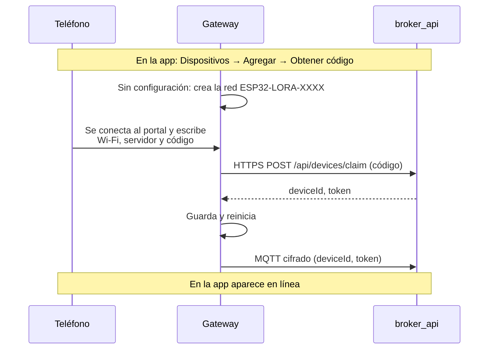

# Uso del gateway: vinculación, portal y problemas

El gateway es el ESP32 con Wi-Fi que se vincula en la app y habla con broker_api. Cómo funciona por dentro: [ARQUITECTURA.md](ARQUITECTURA.md). Protocolo con el servidor (tópicos y mensajes): `broker_api/docs/MQTT.md`.

- [Qué hace](#qué-hace)
- [Primera configuración (vinculación)](#primera-configuración-vinculación)
- [Monitor serie](#monitor-serie)
- [Reconfigurar (cambiar Wi-Fi o IP del servidor)](#reconfigurar-cambiar-wi-fi-o-ip-del-servidor)
- [Problemas comunes](#problemas-comunes)
- [Seguridad](#seguridad)

## Qué hace

- Portal de configuración propio: Wi-Fi, servidor y **código de vinculación** (sin escribir id ni token a mano). Se vuelve a abrir con **BOOT 5 s** para cambiar la red o la IP sin perder la vinculación.
- **Todo cifrado**: canjea el código por HTTPS y se conecta por `wss://` o `mqtts://`, validando el certificado del servidor.
- **Transporte a elegir en el portal**: WebSocket (`wss`, por el mismo puerto que la API: pasa por cualquier hosting con HTTPS) o TCP (`mqtts`, puerto 8883).
- Enciende/apaga el motor del nodo por LoRa con los comandos de la app y confirma cada uno (`ack`) cuando el nodo lo confirma. Su LED azul muestra el estado del motor.
- Informa su estado al conectar, al cambiar y cada 30 s (latido).
- **Última voluntad** MQTT: si se corta la corriente, el broker avisa a la app en ~22 s.
- Informa el **motivo del último reinicio** (corte de energía, caída de voltaje, watchdog…).
- Reconexión automática del Wi-Fi, reconexión MQTT con espera creciente (1 s → 30 s) y **watchdog** de 30 s.
- Rechaza comandos repetidos, fuera de la lista blanca o de más de 30 s (esto último solo si tiene la hora por NTP, es decir, con internet).

## Primera configuración (vinculación)



1. Arranca **broker_api** (`pnpm dev`, con TLS configurado) y la app. La PC y el ESP32 deben estar en la misma red, con el puerto **3443** (HTTPS y WebSocket) permitido en el Firewall de Windows; también el **8883** si eliges TCP.
2. En la app: **Dispositivos → Agregar** → nombre → **Obtener código** (vale 10 minutos).
3. Enciende el **gateway** con el monitor serie abierto. Sin configuración, el LED parpadea y crea la red **`ESP32-LORA-XXXX`**. Su clave aparece en el monitor (`[boot] Clave del portal de este equipo: K7QMX-2PARN`): **anótala en una etiqueta pegada al equipo**, es la misma para siempre.
4. Conéctate a esa red desde el teléfono. Se abre el portal (si no, entra a `http://192.168.4.1`) → **Configure WiFi**.
5. Elige tu red Wi-Fi y su clave, escribe la **IP local de la PC** con broker_api (p. ej. `192.168.100.7`, no `localhost`), deja **Conexión** en `wss` y los puertos 3443 y 8883, y escribe el código.
6. Al guardar, el ESP32 canjea el código, guarda su id y token y se reinicia. En la app aparece como **en línea**.

## Monitor serie

En el monitor serie (`pio device monitor`, 115200 baudios) se ve cada paso. Un arranque normal se ve así:

```
[boot] Firmware 0.4.0
[boot] Clave del portal de este equipo: K7QMX-2PARN (anótala en una etiqueta)
[boot] Dispositivo 4ce6a204-…, servidor 192.168.100.7 (WebSocket)
[lora] Radio lista: 915.0 MHz, SF9, 10 dBm
[lora] Nodo del motor conectado
[wifi] Conectado, IP 192.168.100.23
[mqtt] Conectando a wss://192.168.100.7:3443/mqtt...
[mqtt] Conectado
[cmd] Motor: encender (enviando al nodo por LoRa)
[cmd] Motor ENCENDIDO (confirmado por el nodo)
```

| Prefijo | Qué informa | Módulo |
|---|---|---|
| `[boot]` | Arranque, versión, clave del portal, botón BOOT | `main.cpp` |
| `[config]` | Portal, canje del código, configuración guardada | `provisioning`, `config_store` |
| `[wifi]` | Conexión y desconexión de la red | `main.cpp` |
| `[mqtt]` | Conexión con el broker, errores de TLS (`[mqtt] TLS: ...`) o de red, reintentos y credenciales rechazadas | `mqtt_link` |
| `[cmd]` | Comandos ejecutados, repetidos o rechazados | `commands` |
| `[lora]` | Radio y conexión con el nodo | `remote_motor`, `src/lora/` |
| `[motor]` | (nodo) Motor encendido/apagado, apagado por seguridad | `src/nodo/main.cpp` |

## Reconfigurar (cambiar Wi-Fi o IP del servidor)

Con el equipo **ya funcionando**, mantén presionado **BOOT 5 segundos**. Se reinicia en el portal: el LED parpadea lento y aparece la red `ESP32-LORA-XXXX` con la clave de la etiqueta. Mientras el portal está abierto, el equipo se ve desconectado en la app.

En el portal (**Configure WiFi**) dice *"Este equipo ya está vinculado"*. Cambia solo lo que necesites:

| Quiero… | SSID y contraseña | Servidor, conexión y puertos | Código |
|---|---|---|---|
| Cambiar de red Wi-Fi | La red nueva | Sin cambios | **Vacío** |
| Cambiar la IP o dominio del servidor | **Vacíos** (conserva la red actual) | La IP o dominio nuevo (en producción, puerto API **443**) | **Vacío** |
| Cambiar entre WebSocket y TCP | Vacíos | **Conexión**: `wss` o `mqtts` | **Vacío** |
| Vincularlo a otra cuenta | Vacíos o la red nueva | Sin cambios | Un código nuevo de la app |

Al presionar **Save** guarda y se reinicia. Con el código vacío sigue siendo **el mismo dispositivo** en la app, con su historial. Si nadie usa el portal durante 5 minutos, se cierra solo y el equipo vuelve a funcionar como estaba.

Si cambias la IP del servidor, corre antes `pnpm certs:dev` en broker_api: el certificado tiene que incluir la IP nueva. La CA no cambia, así que el firmware no se recompila.

**Servidor en Render** (prueba en internet): Servidor `<servicio>.onrender.com` (sin `https://`), Conexión `wss`, Puerto API `443`. El certificado de `onrender.com` es de Google Trust Services: el `ca_cert.h` generado por `pnpm certs:dev` ya incluye sus raíces (si tu firmware es anterior, regenéralo y súbelo). Guía completa en `broker_api/docs/DESPLIEGUE.md`.

### Otras situaciones

| Situación | Qué pasa |
|---|---|
| Borrar todo (de fábrica) | Presiona **EN** y, justo después de soltarlo, mantén **BOOT** 3 s. Borra Wi-Fi, servidor y vinculación y abre el portal; hará falta un código nuevo. Si BOOT ya estaba presionado al soltar EN, la placa entra en modo de subida de firmware: presiona EN otra vez |
| El dispositivo se borró en la app o se rotó su token | Tras 3 rechazos seguidos del broker, borra sus credenciales y abre el portal (el Wi-Fi se conserva) |
| Venía de un firmware sin cifrado | Al arrancar pasa solo los puertos guardados 3000/1883 a 3443/8883 y conserva la vinculación |

## Problemas comunes

| Síntoma | Causa | Solución |
|---|---|---|
| Al subir: `Wrong boot mode detected (0x13)` o se queda en `Connecting......` | El monitor serie tiene el puerto abierto, o la placa no entró sola al modo de descarga | Cerrar el monitor (Ctrl+C) y volver a subir. Si sigue, mantener **BOOT** mientras dice `Connecting...` y soltarlo cuando empiece `Writing at...` |
| Error al compilar: `ca_cert.h: No such file or directory` | Falta generar las CAs | `pnpm certs:dev --firmware <ruta de esta carpeta>` en broker_api |
| `[mqtt] TLS: X509 - Certificate verification failed…` | La IP configurada no está en el certificado del servidor, o el firmware tiene otra CA | `pnpm certs:dev --host <IP>` en broker_api y reiniciar la API; si la CA cambió, recompilar y subir |
| `[mqtt] Sin conexión con el servidor (errno …)` | No llega al servidor: IP equivocada, firewall o API apagada | Revisar la IP (portal con BOOT 5 s), el firewall (3443, u 8883 con TCP) y que broker_api esté corriendo con TLS |
| Conecta y se desconecta enseguida por WebSocket | La API no tiene `/mqtt` (versión vieja) o el proxy no deja pasar WebSocket | Actualizar broker_api; en el proxy, permitir el *upgrade* a WebSocket (Caddy lo hace solo) |
| `[config] No se pudo conectar con el servidor (connection refused)` | Puerto API equivocado (p. ej. 3000) o HTTPS apagado | Puerto **3443** en el portal; `TLS_CERT_FILE` en el `.env` de broker_api |
| `[config] El servidor rechazó el código (HTTP 400)` | Código vencido (10 min), ya usado o mal escrito | Generar otro en la app |
| No conozco la clave del portal | Se perdió la etiqueta | Conectar por USB y abrir el monitor: aparece al arrancar |
| BOOT 5 s no hace nada | El equipo está en el portal (ahí no se usa) o se soltó antes | Mirar el monitor: `BOOT soltado antes de tiempo` |

Problemas de la radio o del nodo: [LORA.md](LORA.md#monitor-serie). Más casos de certificados: `broker_api/docs/CERTIFICADOS.md`.

## Seguridad

- **Clave del portal propia de cada equipo**: se genera al azar la primera vez y se guarda en la NVS en un espacio que no se borra ni con el reinicio de fábrica. Se ve en el monitor serie al arrancar; anótala en una etiqueta. Si se pierde, conecta el equipo por USB y mira el monitor. Definir `CONFIG_AP_PASSWORD` en `include/gateway_config.h` fija una clave común (solo para pruebas).
- El token se guarda sin cifrar en la flash. Si el equipo se pierde, bórralo o rota su token desde la app: su conexión se corta al instante.
- La conexión con broker_api va cifrada (HTTPS y MQTTS) y el ESP32 rechaza un servidor cuyo certificado no esté firmado por las CAs de `ca_cert.h`, antes de enviar el token. Si el log muestra `[mqtt] TLS: ...`, el certificado del servidor no corresponde a la IP configurada o a la CA del firmware.
- No se revisa la fecha de vencimiento del certificado (el core no lo soporta); el del servidor de desarrollo dura 825 días.
- Seguridad del enlace LoRa: [LORA.md](LORA.md#seguridad). Del servidor: `broker_api/docs/SEGURIDAD.md`.
